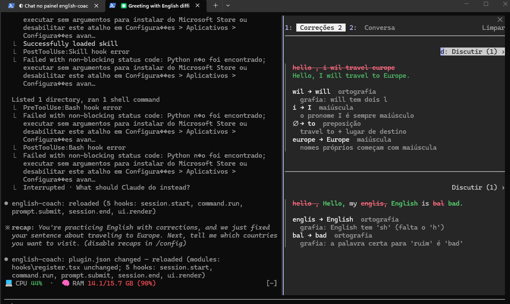

# english-coach

Mod para o Claude Code que ajuda a treinar inglês enquanto você trabalha. Cada mensagem que você escreve em inglês é revisada pelo Claude Haiku, e as correções aparecem num painel ao lado do chat, com uma explicação curta em português de cada erro. No mesmo painel dá para tirar dúvidas com um tutor, sobre uma correção ou sobre qualquer coisa de inglês.

A mensagem é enviada **exatamente como você escreveu**: o mod não altera nada e não atrasa o envio. A correção roda em paralelo e aparece no painel 1–2 segundos depois.



```
 Correções 2   Conversa                    Limpar
──────────────────────────────────────────────────
                                       Discutir ›
▎ I have did the tests yesterday
▎
▎ have did → did  verbo
▎   com "yesterday" usa-se o passado simples
```

(No painel, `have` aparece riscado em vermelho.)

## Instalação

No prompt do Claude Code (terminal):

```
/plugin install english-coach --marketplace newonne/english-coach
```

Responda `y` para adicionar o marketplace e escolha o escopo **user** (Enter). O mod já fica ativo na sessão atual e em todas as próximas.

Pelo shell:

```
claude plugin install english-coach --marketplace newonne/english-coach
```

No app desktop (onde `/plugin` não roda): clique no **+** ao lado da caixa de prompt → **Plugins** → **Add marketplace** com `newonne/english-coach` → **Add plugin**.

## Atualização

Pelo shell, busque a versão nova do marketplace e atualize o mod:

```
claude plugin marketplace update english-coach
claude plugin update english-coach
```

Depois reinicie o Claude Code (ou rode `/reload-plugins` numa sessão aberta) para carregar a versão nova.

## Como usar

- Digite `/english` para abrir o painel **English**. Ele não abre sozinho; a revisão roda mesmo com o painel fechado.
- Escreva seus pedidos em inglês normalmente. Se houver erro, ele aparece na aba **Correções**: a frase uma vez só, com o que estava errado riscado em vermelho e o certo em verde, e embaixo cada erro com o tipo (verbo, preposição, maiúscula…) e a regra numa linha.
- **Discutir ›** abre uma conversa com o tutor sobre aquela correção. Cada correção tem a sua conversa, que continua lá quando você volta.
- A aba **Conversa** é um chat livre com o tutor, sem nenhuma correção junto: dá para perguntar, por exemplo, como se diz alguma coisa em inglês.
- O tutor responde em português, com os exemplos em inglês. As conversas são chamadas separadas ao Haiku e não entram no contexto da sua sessão do Claude.
- Cada sessão do Claude tem o seu painel: uma sessão nova ou um `/clear` começa vazio, e um `--resume` traz de volta as correções e conversas daquela sessão. **Limpar** apaga as correções da sessão.
- Com o painel em foco: **1** abre Correções, **2** abre Conversa e **d** discute a correção mais recente.

## O que não é revisado

- Mensagens em português (ou qualquer idioma que não seja inglês)
- Comandos com `/`
- Mensagens com menos de 3 palavras
- Textos acima de 1500 caracteres (logs e código colados)

Detalhes de chat casual, como começar com letra minúscula ou não colocar ponto final, são ignorados de propósito.

## Custo

Cada mensagem em inglês faz uma chamada curta ao Claude Haiku, e cada pergunta ao tutor faz mais uma, cobradas na mesma conta/credenciais da sua sessão do Claude Code. É um custo bem baixo, mas existe.

## Licença

[MIT](LICENSE)
